# shiro research program

This document carries out the long research brief in **stages**. Each stage is real work: code read, numbers measured, math written down. Nothing here is a one-line survey. The [research index](#research-index) tracks what is done and what is still open.

Every claim is labelled with one of three tags:

- **[E] Established.** Published, provable, or measured by us. Measurements cite `results/runs.jsonl`.
- **[H] Hypothesis.** A plausible engineering improvement that has not been tested yet.
- **[O] Original idea.** A proposal that, as far as we know, has not been done this way. Known prior art that resembles it is always named.

Citations are given from primary sources, by author, year and venue. Links have not been individually re-checked yet; that is a stage-2 task.

---

## Research index

| Stage | Content | Status |
|---|---|---|
| **1** | F: technical audit of the repo · Part 8: limits that bound what shiro can win · H: research proposals · I: immediate action plan · core bibliography | **this document** |
| 2 | B: historical timeline · C: algorithm comparison (LZ family, BWT, PPM, CM, ANS) with costs · D: mathematical reference (deriving every formula used in `model.rs` and `online.py`) | open |
| 3 | E: neural compression review (NNCP, cmix's LSTM, LLM-as-compressor, learned image codecs and which of their ideas transfer to text) | open |
| 4 | Parts 6, 9 and 10: ideas from outside compression; a deterministic-inference engineering study; a benchmark suite beyond enwik | open |

Open questions carried forward:
- **Q1.** What does the honest, decodable hybrid cost? Without P1, +5.8% (17,598,163 on enwik8). With P1, measurement running.
- **Q2, answered.** The second pass's gain shrinks as the file grows. NN-only, `--inner 2` vs 1 pass: −3.3% on enwik7, −2.25% on the first 20 MB of enwik8, about −1.2% on enwik8. The enwik8 figure combines B = 24 + inner 2 being level with B = 32 + 1 pass, and B = 32 costing +1.25% vs B = 24 on the 20 MB prefix. So extra passes mostly speed up early learning, which is consistent with the 8.5 learning-curve picture. Fewer streams help at every size measured. Implication for P4: replay has to bring *new* signal, not just repeat the current block.
- **Q3.** Can GPU training be made bit-reproducible, and at what speed cost?

---

## F. Technical audit

### F.1 What the code actually does

```mermaid
flowchart LR
  subgraph NN["nn/online.py (GPU, PyTorch)"]
    T[tokenizer: letter runs to 16k-word vocab, else bytes] --> S[B lockstep streams, T=256 blocks]
    S --> M[transformer d384 x 6 layers, 23M params, online AdamW]
    M --> G[trie marginaliser: P token to P byte to 8 bit probabilities]
  end
  G -- "side file: 8 x u16 per byte" --> X
  subgraph CM["crates/shiro-core (CPU, Rust)"]
    X[24 hashed contexts + 2 match models] --> I[per-context inputs: slot, bit-history, run, confidence]
    I --> MX[8 context-selected mixers] --> F2[final mixer, selected by c0] --> A[5 APMs + learned blend]
  end
  A --> AC[binary arithmetic coder, 24-bit probabilities]
```

**[E] Step by step, per bit** (`model.rs::predict` / `update`):

1. **Contexts.** 24 contexts are hashed at each byte boundary and re-hashed at the nibble boundary:
   - orders 0–6, 8, 12 and 16;
   - word, bigram, trigram and skip-word;
   - sparse bytes;
   - column, line head, bracket nesting;
   - indirect order-2;
   - XML tag, number shape, markup segment.
2. **Buckets.** Each context owns one 64-byte bucket per (context, nibble), holding a 16-bit checksum, a run record and 15 slots. Each slot carries p, n and a bit history h. A lookup probes 3 buckets and evicts the lowest-count one.
3. **Inputs, 4 per context:**
   - `st(p_slot)`;
   - `st(imap[h, conf])`, a bit-history map indexed by history and a confidence bucket;
   - the run prediction;
   - a confidence term `(p − ½)·2`.

   On top of those come 2 match models × 2 inputs, a bias, and, when present, the NN's `st(p)` and a presence flag.
4. **Mixing.** 8 logistic mixers, selected by:
   - the partial byte c0;
   - match length;
   - the previous byte c1;
   - hit count × bit position;
   - the character class of the last two bytes;
   - the NN-confidence bucket;
   - word length × class;
   - the previous two bytes.

   A final mixer, selected by c0, mixes their outputs.
5. **Refinement.** 5 APMs refine the final mixer's output, keyed by c0, c0·c1, hashed order 2, match state and hashed order 3. The final probability is ½·(fixed blend) + ½·(learned blend).
6. **Coding.** A carryless 32-bit binary arithmetic coder. **[E]** It round-trips (`cargo test`), and all floating point goes through `dmath` (basic IEEE operations only) so encoder and decoder agree bit for bit.

**[E] NN side** (`online.py`):

1. **Tokens.** Text becomes word or byte tokens, about 1.90 bytes per token on enwik8.
2. **Streams.** The tokens are split into B contiguous streams. Each step predicts T new tokens per stream with T tokens of left context, then takes one AdamW step (or `--inner k` steps) on that same batch.
3. **Bit predictions.** Token probabilities become per-bit probabilities through a vocabulary trie. Inside a word, every byte uses the distribution of the word's **first** token, and a lookahead head predicts the delimiter.
4. **Side file.** The result is written as a side file. `shiro eval --side` reads it.

### F.2 Confirmed findings (from the source and from measurement)

| # | Finding | Severity | Evidence |
|---|---|---|---|
| **A1** | **The hybrid numbers are not decodable as measured.** The NN trains B streams in lockstep, so its prediction at step s depends on training over *all* streams at steps < s. A decoder must therefore produce bytes in **block-interleaved** order: step s, then streams 0…B−1. `shiro eval --side` feeds the CM in *file* order, which a decoder cannot reproduce: stream 0 would need NN steps whose training depends on stream 1, which isn't decoded yet. In the decodable order the CM's order-n contexts break at every block boundary (~486 bytes). | **critical** for every hybrid claim | Code: `online.py` stream layout vs `lib.rs::eval`. Measurement: `eval --order` + `tools/schedule.py`. **enwik8, B = 24, T = 256 (205,776 blocks, mean 486 B): CM 17,780,730 → 19,421,393 (+9.2%); hybrid 16,637,907 → 17,598,163 (+5.8%).** The fix is P1. |
| **A2** | **GPU training is not reproducible.** Measured: two identical enwik7 runs gave NN-only 2,523,937 vs 2,530,883 (0.27% apart). Training runs under bf16 autocast with cuBLAS reductions in nondeterministic order. There's no `torch.use_deterministic_algorithms`, and no fixed kernel set. A decoder on another GPU, driver or PyTorch version, or even a rerun, would compute different probabilities, and the arithmetic decoder would desynchronize after the first differing bit. | **critical** for an archive | Code: `online.py` training loop. |
| **A3** | **The vocabulary is not paid for.** `Vocab.build` scans the whole file before coding. A decoder needs the 16,384-word list, and that cost is missing from every NN and hybrid number. Fix it either by coding the vocabulary as a header (estimated at roughly 0.05–0.1 MB with xz) or by building the vocabulary online. | moderate (~0.3–0.6% on enwik8, less on enwik9) | Code: `online.py` main, `tokenizer.py::Vocab.build`. |
| **A4** | **5.3% of bytes get no NN prediction.** 94,744,874 of 100M bytes have a record. The rest are the inside letters of out-of-vocabulary words and the delimiter after them. Once a prefix leaves the trie, the decoder *knows* those letters are byte tokens, so the NN's prediction at that token position is valid and causal. It just isn't used yet. These are the rare-word bytes, among the most expensive in the file. | moderate, cheap to fix | Log: `records 94744874/100000000`. Code: `tokenizer.py` (`if node < 0: break`). |
| **A5** | **The archive format has no model version and no checksum.** The header is `XZP0` + table bits + length. Every model change (v3 → v4.2) silently changes the format, so an old archive decodes to garbage with a new binary, and nothing detects corruption. | moderate (correctness hygiene) | Code: `lib.rs` header. |
| **A6** | **The CM is getting slow.** 10.5 µs/B (v3) → 13.4 µs/B (v4.2), with the hybrid fusion at 13.4 µs/B and 7.5 GB RSS. enwik9 would take about 3.7 h on CPU. That's fine for a research box, but it's a trend. Hot spots, by reading the code: 9 mixer dot products of ~100 inputs per bit, scalar f32; `dmath::stretch` called 7× per bit in the learned blend; `squash` via `dmath::exp` in every mixer. A 4096-entry stretch table and keeping the blend in the stretch domain would remove most of the transcendental calls. **[H]** Expected 1.3–1.6× faster with identical output, if the tables are built from `dmath`. | low now, high for enwik9 iteration speed | `runs.jsonl` secs; code `Mixer::predict`, `Model::predict`. |
| **A7** | **The hash tables don't grow with input size.** At `--bits 22`, 24 tables × 4M buckets × 64 B ≈ 6 GB. enwik9 has 10× more distinct high-order contexts, and the replacement policy (lowest `s[0].n`) will churn. **[H]** Per-context table sizes (small for orders 0–2, large for orders 6–16 and the word contexts) would beat one global size. | medium for enwik9 | Code: `Model::new` (`tbits`). |
| **A8** | **The run log was being overwritten.** `remote.py sync` shipped the local `results/runs.jsonl` over the box's copy on every sync, so most of day-2's records there were lost. Fixed; lost milestones were backfilled from session logs and tagged `backfill`. | fixed | Commit `28dc1b6`. |
| **A9** | **Mismatch between training objective and the probabilities used.** The NN trains on token cross-entropy, plus 0.3 × the lookahead loss. The CM consumes the *marginalised per-bit* probabilities, where every byte inside a word uses the first token's distribution. The objective never sees the cost of the bytes after the first. It is a proxy, not the coded loss. | design question | Code: loss in `online.py`. |
| **A10** | **A Python loop sits in the hot path.** Side records are gathered with a per-row Python loop (B·T = 6,144 iterations per step) before the GPU marginaliser runs. It is not the bottleneck at 0.3 s/step, but it caps throughput once the model is faster. | low | Code: `online.py` (`for r, g in enumerate(gpos_np)`). |

### F.2b The decodable-order cost, measured (P1 in practice)

`tools/decodable.sh` runs the CM alone on enwik7 in four orders: file order (not decodable), interleaved with shared history, per-stream history (P1), and P1 plus a per-stream indirect table (`ind2s`). Each entry is the cost vs file order (1,961,099).

| B (streams) | T (tokens/block) | Shared history | P1 | P1 + ind2s |
|---|---|---|---|---|
| 24 | 256 | +8.07% | +4.51% | **+3.57%** |
| 24 | 1024 | +4.40% | +3.16% | +2.66% |
| 24 | 4096 | +2.36% | +1.83% | +1.63% |
| 8 | 256 | +6.82% | +3.29% | +2.63% |
| 4 | 256 | +5.84% | +2.41% | +1.94% |
| 2 | 256 | +4.50% | +1.39% | +1.14% |

**[E] What this rules in and out:**
- **Ruled out: table capacity.** With 4× the tables (`--bits 22`) the gap is the same: +3.51% vs +3.57%.
- **Ruled out: match models.** Per-stream match state recovered only 0.1% on enwik8.
- **Ruled in: interleaving.** The cost falls with fewer streams and with longer blocks, but slowly.

The remaining loss is **recency kept inside shared statistics**. Each slot's bit history, each bucket's run record, and the fast-adapting mixer and APM weights remember the last time a context occurred. In file order that last occurrence is usually from the same article; interleaved, it often comes from another region.

**On enwik8, B = 24, T = 256** (P1 without `ind2s`):

| | Shared history | P1 | P1 + per-stream match state |
|---|---|---|---|
| CM | 19,421,393 | 18,694,996 | 18,674,551 |
| Hybrid | 17,598,163 | 17,312,629 | **17,294,386** |

The file-order references are 17,780,730 (CM) and 16,637,907 (hybrid).

**[E] Why B exists at all.** It is decoder latency. A decoder must run the NN one token at a time, because it needs token t before it can predict t + 1, and B streams let each forward pass carry B tokens. On the NN side, B makes little difference between 8 and 24 (20 MB prefix: B = 8: 4,770,852; B = 12: 4,755,647; B = 24: 4,768,825), and B = 32 is +1.25%. On the CM side, the cost falls steadily with B.

**[H] So decoder speed buys compression.** A single-token forward pass that is fast enough to allow B = 2–4 would recover roughly 1.5–2.5% on the CM side. Today's PyTorch launches about 100 small kernels per step, so it is launch-bound at small B. A fused, deterministic custom kernel would also fix A2. Integer accumulation is exact in any order, so the encoder's batched forward and the decoder's incremental forward would give identical results. **This is the strongest argument for writing our own GPU engine.**

### F.3 What is genuinely good (keep it)

- **[E] Deterministic CM math** (`dmath`). It is the right foundation. Most hobby CM ports get cross-platform float drift wrong.
- **[E] Bucket layout.** One cache line per (context, nibble), checksummed, with inheritance from the parent order. It gave the single largest CM gain (v0 → v1, −8.2% on enwik7).
- **[E] Token → bit marginalisation through a trie, with a lookahead head for the delimiter.** It lets a word-level LM drive a bitwise CM without the CM knowing about tokens. As far as we know this precise construction (first-token distribution, plus a Q head for the delimiter, plus out-of-vocabulary mass) is our own. NNCP and cmix work at byte or BPE level in different ways.
- **[E] Ablation switches on every new component** (`SHIRO_TUNE=xoff=…`, `m7=0`, `fm=0`, …), so every claimed gain is measured against its own absence.

### F.4 Fundamental limitations of the current approach

1. **Lockstep streams trade compression for GPU throughput.** Every stream after the first starts with no context. In the decodable order the CM loses its context continuity too (A1). The true cost of B is untested, and bet **B4** (a global match memory) is exactly the mitigation.
2. **One gradient step per block is a weak learner.** The model sees each token once. Enwik7 showed it is under-trained (`--inner 2` −3.3%). Enwik8 didn't confirm it (Q2).
3. **Decodability (A1) and reproducibility (A2) aren't side issues.** They decide whether the NN can be part of an LTCB entry at all. Until both are solved, the CM alone (17,780,730 on enwik8) is the only *real* number.

---

## Part 8. Limits that bound the problem

These are the results that decide what is worth trying. Proofs are sketched; full derivations go in stage 2 (deliverable D).

**8.1 No compressor beats another on every input. [E]** There are 2ⁿ strings of length n, but only 2ⁿ − 1 binary strings shorter than n. So any lossless code that shrinks some inputs must expand others; this is the counting argument. Against an arbitrary competitor this is unavoidable: any input shiro saves bytes on is paid for elsewhere. LTCB is one fixed file, so the real question is only *how much prior structure about enwik9 can we exploit, and for how few bytes of decompressor*.

**8.2 What a model costs. [E]** LTCB counts compressed size + decompressor size. That is a two-part MDL code (Rissanen 1978): L(model) + L(data | model).

An **online** learner avoids transmitting parameters. Its prequential code length (Dawid 1984) is L = Σₜ −log₂ p_{θₜ}(xₜ | x₍<ₜ₎), where θₜ is trained only on the past.

For a k-parameter regular parametric family, the regret of the best online or Bayesian mixture against the best fixed parameter in hindsight is (k/2)·log₂ n + O(k). That is the same order as sending the parameters at optimal precision (Rissanen 1986; Grünwald 2007).

So "online learning means a free model" is wrong in a precise sense: you pay the same order of bits through slow early predictions. That is exactly what the large bpc gap between enwik7 (2.02) and enwik8 (1.56) for our NN shows. The real choice is *where* you pay:
- in decompressor bytes (a stored prior: bet B5);
- in early prediction loss (online learning);
- or in compute (more passes, replay).

**8.3 There is no computable optimal compressor. [E]** Kolmogorov complexity K(x) (Solomonoff 1964; Kolmogorov 1965; Chaitin 1966) is the length of the shortest program that prints x. It is uncomputable, and it is approximable from above only. Every practical compressor is a resource-bounded upper bound on K(enwik9). This is why compute matters in principle: with more time a compressor can search more of the program space (Levin's universal search pays a constant factor per bit of program length). In practice, the bits gained per FLOP is the figure of merit (8.5).

**8.4 Universality. [E]** Universal codes, such as LZ78 (Ziv & Lempel 1978), CTW (Willems, Shtarkov & Tjalkens 1995) and PPM in the limit, approach the entropy rate of *any* stationary ergodic source. But the convergence is slow: the redundancy of LZ78 decays only like O(log log n / log n). Mixtures with a good *prior* converge much faster on the sources they favour. Context mixing and neural models are fast-converging mixtures with strong text priors built into their structure (word contexts, attention). Universality is the floor, not the goal.

**8.5 Compute vs compression. [H→E]** Empirically, LM loss follows a power law in parameters and data (Kaplan et al. 2020; Hoffmann et al. 2022). For online compression, the instantaneous loss after t tokens behaves like H∞ + A·t^(−β). The paid cost is the integral, which gives an average of H∞ + A·N^(−β)/(1−β). The formula lab has this curve (`online` in `tools/dash/lab.json`).

Fitting it to our two NN points (enwik7 2.02 bpc, enwik8 1.555 bpc) gives one equation in three unknowns. **We need at least 3 file sizes to fit it.** That is a cheap experiment: the 20 MB prefix run in progress is the third point.

**8.6 What this means for shiro.**
- The NN's value grows with file size. Its early loss amortises, which is why the hybrid gain went from −2.7% on enwik7 to −7.3% on enwik8.
- So enwik9 *should* favour the NN more than enwik8 does. That is a hypothesis to measure on a prefix of enwik9, not a fact.
- The CM's value is fast convergence on exact repeats, which the NN learns slowly.
- The mixture is right in principle: it has the regret of the better model plus O(log) mixing overhead.

---

## H. Research proposals, ranked

Ranked by (expected bytes on enwik9) × (feasibility) ÷ (cost), with the decodability work first because everything else depends on it.

| Rank | Proposal | Tag | Prior art | Expected gain | Cost | Difficulty |
|---|---|---|---|---|---|---|
| 1 | P1 Stream-aware CM state | [H] | none known for CM; NNCP has a single stream | recovers most of A1's loss | low | low |
| 2 | P2 Deterministic NN arithmetic | [E/H] | NNCP's own deterministic library (Bellard 2019, 2021) | makes the hybrid real | high | high |
| 3 | P3 OOV continuation records | [O] | | 0.3–1% hybrid | low | low |
| 4 | P4 Replay with surprise priority (B2) | [H] | prioritized replay (Schaul et al. 2016); RHO-loss (Mindermann et al. 2022); dynamic evaluation (Krause et al. 2018) | 2–5% NN | medium | medium |
| 5 | P5 Encoder-steered training (B7) | [O] | two-pass and side-information coding in general; "learning to learn" | 1–3% NN | medium | medium |
| 6 | P6 NN hidden state as mixer selector (B1) | [H] | Gated Linear Networks (Veness et al. 2017/2021); cmix's LSTM feeds predictions, not gates | 0.3–1% hybrid | low | low |
| 7 | P7 Online vocabulary | [O] | adaptive dictionaries (LZW-style); NNCP uses a fixed BPE in the header | removes A3, ~0.3% | low | low |
| 8 | P8 Tokens trained on the coded loss | [O] | | 0.5–2% NN | medium | medium |
| 9 | P9 Semantic article reordering (B3) | [E/H] | Hutter Prize entries reorder articles (STARLIT and successors) | 0.5–1.5% | medium | medium |
| 10 | P10 Structured field models (B6) | [E/H] | paq8 XML/text models; WRT/DRT dictionary transforms | 0.2–0.6% | low | low |
| 11 | P11 Compact prior (B5) | [H] | weight sharing and quantization (Han et al. 2016; Ullrich et al. 2017) | unknown; 1–4% if it works | high | high |
| 12 | P12 Adaptive compute per region | [O] | early-exit and conditional computation in neural networks | speed, not bytes | medium | medium |

### P1. Stream-aware CM state [H] — the fix for A1

**Idea.** In decodable order, the CM sees block (s, b) right after block (s, b−1), which comes from a different part of the file. Today every context and history then continues from the wrong predecessor. Instead, keep the *history* per stream and the *statistics* shared:
- each stream b gets its own byte history buffer, c8, word, line and bracket state, and match pointers;
- all streams share the hash tables, the mixers and the APMs.

When the decoder switches to stream b, it swaps in stream b's history. Contexts are then computed from the bytes that truly preceded this one in the file, while the statistics still learn from all streams.

**Why it should work.** The loss in A1 comes from wrong *contexts*, not from fewer *statistics*. The tables already pool all streams, so with correct contexts the CM sees exactly the same predictive situations as in file order. Only the order of updates differs, and adaptive counters are weakly sensitive to that.

**Encoder/decoder.** They are symmetric. Both know the schedule from the token counts, so it needs no side information.

**Cost.** B × (history buffer + small state). With B = 24, at most a few MB.

**Validation.** Compare `eval --order` on enwik8 in three settings: (a) file order, (b) interleaved, (c) interleaved with stream-aware state. Prediction: (c) is within 0.3% of (a), and (b) is clearly worse. The measurement of (b) is running.

### P2. Deterministic NN arithmetic [E/H] — the fix for A2

**Options**, roughly in order of how fast they'd run:
1. **Fixed-point (int8/int16) matmuls with int32 accumulation, in a fixed order.** These are exact on every device. Training also needs deterministic gradients, so use integer-friendly optimizer updates or float updates in a fixed order on the CPU.
2. **GPU float with deterministic kernels**, pinned versions, and a fixed reduction order (`torch.use_deterministic_algorithms(True)`, a fixed cuBLAS workspace). This is reproducible on the *same* GPU, driver and library stack only, which is enough for a benchmark run but fragile.
3. **CPU float in strict IEEE order**, as NNCP does with its own library. It is portable but slow.

**Validation.** Encode then decode on the box, and require bit identity. Then run the same model on two different machines.

**Prior art.** NNCP (Bellard) shows (3) is workable at LTCB scale.

### P3. OOV continuation records [O] — the fix for A4

**Idea.** When a letter run leaves the trie at position k, the decoder knows the run is out of vocabulary, so the tokenizer emitted it as byte tokens t, t+1, …. For every later letter j > k, the NN's distribution at token position t+j (restricted to byte tokens and renormalised) is a valid, causal prediction. The delimiter after the run is token t+L, predicted directly.

**Math.** P(b | the run is OOV, prefix) = P_{t+j}(b) / Σ_{b'∈bytes} P_{t+j}(b').

**Cost.** It's one gather from logits the model already computes.

**Result (enwik7, same CM): records 95.7% → 100%; hybrid 1,911,138 → 1,904,474 (−0.35%). [E]** Validation still to do: Then the fused enwik8 size, using the same saved weights and seed, compared against 16,637,907 (or its interleaved equivalent).

### P4. Surprise-prioritized replay (B2) [H]

**Idea.** After predicting block s, also train on k earlier blocks, chosen with probability ∝ (recent loss − reference loss). That is "reducible loss", as in Mindermann et al. 2022, rather than raw loss, so the model doesn't keep replaying noise.

**Why.** Enwik7 says the model is under-trained per token. Uniform `--inner 2` doubles compute for −3.3%. Replay spends the extra compute on *different* data, and prioritisation spends it where learning is still happening.

**Decoder.** The decoder must reproduce the choice, so the priorities must be computed only from already-decoded data. They are.

**Validation.** On the 20 MB prefix at equal FLOPs, compare three settings: 1 pass; 2 passes on the same block; 1 pass + 1 replayed block.

### P5. Encoder-steered training (B7) [O]

**Idea.** The encoder can see the future; the decoder can't. For each block, the encoder tries k training actions (replay yes/no, LR × {0.5, 1, 2}, …) and measures the next block's code length for each. It codes the index of the best one: log₂ k bits per block, at most about 200 KB for 10⁶ blocks with k = 4, and much less with entropy-coded choices. The decoder just follows the coded actions.

**Why it's valid.** It's a two-part code. The choice is paid for, and the decoder needs no lookahead.

**Cost.** k× encoder compute, but decoder compute is unchanged. That matches LTCB, which times decompression less strictly than it counts bytes.

**Validation.** On enwik8 with k = 2 (replay step or not), compare total bytes including the choice bits against always-replay and never-replay.

**Prior art.** Side-information and two-pass schemes in general. We know of no compressor that uses encoder lookahead to steer online training. That novelty claim needs a literature check in stage 3.

### P6. Hidden state as mixer selector (B1) [H]

Today the NN reaches the mixer only through its prediction and a confidence bucket. Instead, project the last hidden state to 8–16 dimensions, hash the sign pattern to select a mixer weight set (GLN-style halfspace gating), and add one more mixer. This lets the CM learn "in contexts that look like *this* to the NN, trust these inputs". Cheap: 16 floats per token added to the side file.

### P7. Online vocabulary [O]

Grow the vocabulary as words are seen: a word enters on its second occurrence, which the decoder can replay from decoded text. The embedding rows of new words start from a character-level composition. This removes A3, adapts on enwik9, and drops the file pre-scan. The risk is that a growing softmax needs care, for example a fixed-size table with LRU reuse of rows.

### P8. Train on the coded loss [O]

The bytes inside a word are coded from the first token's distribution through the trie, so the cost actually paid is Σ over bytes of −log₂ p_trie(byte). That is a differentiable function of the logits. Adding it to the loss, with a weight, makes the NN optimise what the arithmetic coder charges. Today's cross-entropy only covers the token.

### P9–P12

**P9. Semantic article reordering.** Order enwik9's articles by embedding similarity and code the permutation (~243k articles). The reordering is lossless if the permutation is stored. Hutter Prize entries already reorder articles. Our angle would be ordering for the *NN's* benefit (topic continuity), not just for LZ-style matches.

**P10. Field models.** Dedicated predictors for revision headers: `<id>` deltas, `<timestamp>` deltas, contributor names. That is cheap, and header text is 4.6% of input but 1.5% of output, so the ceiling is small but certain.

**P11. Compact prior.** Train offline on enwik9 and ship ternary or shared-block weights as part of the decompressor. Worth it only if the saved prediction loss exceeds the weight bytes. Section 8.2 says to test it on a prefix with real byte counts.

**P12. Adaptive compute.** Skip the NN forward pass, or use a smaller one, where the CM's confidence is high (long matches, markup). That buys speed, which buys bigger models within the same time budget.

**Not recommended for text [E-based reasoning]:**
- **Transform coding and quantization (DCT, VQ).** These are lossy, or need residual coding that degenerates to predictive coding for discrete text.
- **Bits-back with latent variables** (Townsend et al. 2019). Its gain comes from latent-variable models of continuous-ish data. An autoregressive text model has no latent to bits-back over.
- **Compressed sensing.** It needs sparsity in a known basis plus tolerance for error. Neither holds for lossless text.

---

## I. Immediate action plan: the next 10 experiments

| # | Action | What would validate it |
|---|---|---|
| 1 | Measure A1: CM and hybrid in decodable order on enwik8. **Running.** | A number. A loss above 1% makes P1 the top priority. |
| 2 | Implement P1 (stream-aware CM state) | Interleaved hybrid within 0.3% of the file-order number. |
| 3 | Implement P3 (OOV continuation records) | Records cover ~100% of bytes; fused enwik8 drops by ≥ 0.3%. |
| 4 | Count A3: code the vocabulary in a header and add it to every NN/hybrid number | An honest total. Then decide on P7. |
| 5 | Settle Q2 on the 20 MB prefix (B 24, B 24 inner 2, B 32). **Running.** | Explains whether passes or streams matter. Decides P4's design. |
| 6 | P4: replay vs a second pass at equal FLOPs, on the 20 MB prefix | Replay beats `--inner 2` at the same GPU time. |
| 7 | Fit the online learning curve (8.5) with 3 file sizes, then predict enwik9 | A falsifiable enwik9 forecast before spending a day on it. |
| 8 | A6: table-driven stretch/squash plus the stretch-domain blend | Identical output (round-trip test), ≥ 1.3× faster. |
| 9 | A5: archive header with model version + CRC32 | An old archive fails loudly; a corrupted one is detected. |
| 10 | P2 feasibility: deterministic GPU inference first, then CPU replay of one block | Bit-identical probabilities across two runs, then across two devices. |

---

## Core bibliography (stage 1)

Primary sources for the claims above. The full annotated bibliography is a stage-2 deliverable.

**Information theory and coding**
- C. E. Shannon, "A Mathematical Theory of Communication", *Bell System Technical Journal*, 1948.
- D. A. Huffman, "A Method for the Construction of Minimum-Redundancy Codes", *Proc. IRE*, 1952.
- J. Rissanen, "Generalized Kraft Inequality and Arithmetic Coding", *IBM J. Res. Dev.*, 1976; R. Pasco, PhD thesis, Stanford, 1976.
- I. H. Witten, R. M. Neal, J. G. Cleary, "Arithmetic Coding for Data Compression", *Communications of the ACM*, 1987.
- J. Duda, "Asymmetric numeral systems: entropy coding combining speed of Huffman coding with compression rate of arithmetic coding", arXiv:1311.2540, 2013.
- P. Elias, "Universal codeword sets and representations of the integers", *IEEE Trans. Inf. Theory*, 1975.
- T. M. Cover, J. A. Thomas, *Elements of Information Theory*, 2nd ed., Wiley, 2006.

**Dictionary and statistical compression**
- J. Ziv, A. Lempel, "A Universal Algorithm for Sequential Data Compression", *IEEE Trans. Inf. Theory*, 1977; "Compression of Individual Sequences via Variable-Rate Coding", 1978.
- T. A. Welch, "A Technique for High-Performance Data Compression", *IEEE Computer*, 1984.
- J. G. Cleary, I. H. Witten, "Data Compression Using Adaptive Coding and Partial String Matching", *IEEE Trans. Communications*, 1984.
- M. Burrows, D. J. Wheeler, "A Block-sorting Lossless Data Compression Algorithm", DEC SRC Research Report 124, 1994.
- F. M. J. Willems, Y. M. Shtarkov, T. J. Tjalkens, "The Context-Tree Weighting Method: Basic Properties", *IEEE Trans. Inf. Theory*, 1995.
- R. Krichevsky, V. Trofimov, "The performance of universal encoding", *IEEE Trans. Inf. Theory*, 1981.
- M. V. Mahoney, "Adaptive Weighing of Context Models for Lossless Data Compression", Florida Tech. Tech. Report CS-2005-16, 2005.
- B. Knoll, N. de Freitas, "A Machine Learning Perspective on Predictive Coding with PAQ8", *Data Compression Conference*, 2012.

**MDL, Kolmogorov complexity, prequential coding**
- R. J. Solomonoff, "A Formal Theory of Inductive Inference", *Information and Control*, 1964.
- A. N. Kolmogorov, "Three approaches to the quantitative definition of information", *Problems of Information Transmission*, 1965.
- J. Rissanen, "Modeling by shortest data description", *Automatica*, 1978; "Stochastic complexity and modeling", *Annals of Statistics*, 1986.
- A. P. Dawid, "Present Position and Potential Developments: Some Personal Views — Statistical Theory: The Prequential Approach", *J. Royal Statistical Society A*, 1984.
- P. Grünwald, *The Minimum Description Length Principle*, MIT Press, 2007.
- M. Li, P. Vitányi, *An Introduction to Kolmogorov Complexity and Its Applications*, Springer (3rd ed. 2008).

**Neural compression and language models as compressors**
- J. Schmidhuber, S. Heil, "Sequential Neural Text Compression", *IEEE Trans. Neural Networks*, 1996.
- F. Bellard, "Lossless Data Compression with Neural Networks" (NNCP), technical report, 2019; NNCP v2 report, 2021.
- G. Delétang et al., "Language Modeling Is Compression", ICLR 2024 (arXiv:2309.10668).
- B. Krause, E. Kahembwe, I. Murray, S. Renals, "Dynamic Evaluation of Neural Sequence Models", ICML 2018.
- J. Townsend, T. Bird, D. Barber, "Practical Lossless Compression with Latent Variables using Bits Back Coding", ICLR 2019.
- J. Ballé, V. Laparra, E. P. Simoncelli, "End-to-end Optimized Image Compression", ICLR 2017; J. Ballé et al., "Variational Image Compression with a Scale Hyperprior", ICLR 2018.
- J. Veness et al., "Gated Linear Networks", arXiv:1712.01897, 2017; AAAI 2021.

**Training dynamics (for P4, P5, P8)**
- T. Schaul, J. Quan, I. Antonoglou, D. Silver, "Prioritized Experience Replay", ICLR 2016.
- S. Mindermann et al., "Prioritized Training on Points that are Learnable, Worth Learning, and Not Yet Learnt", ICML 2022.
- J. Kaplan et al., "Scaling Laws for Neural Language Models", arXiv:2001.08361, 2020; J. Hoffmann et al., "Training Compute-Optimal Large Language Models", NeurIPS 2022.
- S. Han, H. Mao, W. J. Dally, "Deep Compression", ICLR 2016; K. Ullrich, E. Meeds, M. Welling, "Soft Weight-Sharing for Neural Network Compression", ICLR 2017.

**Benchmarks**
- M. Mahoney, Large Text Compression Benchmark, http://mattmahoney.net/dc/text.html.
- Hutter Prize, http://prize.hutter1.net/.
